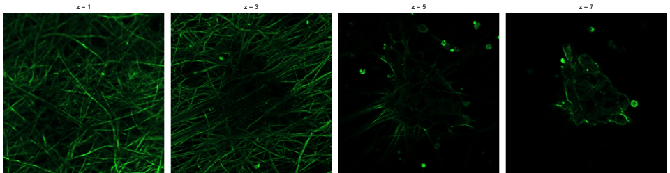
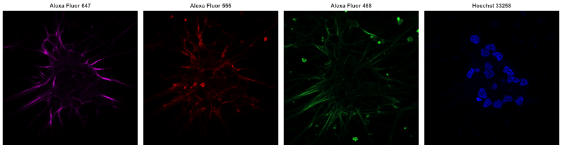
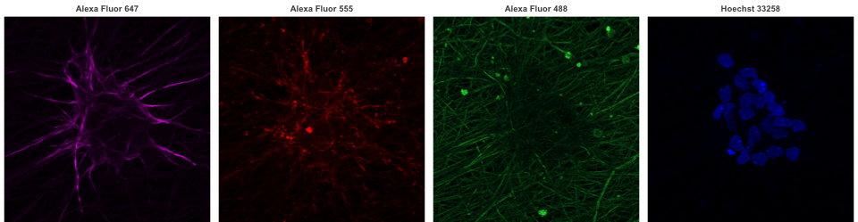
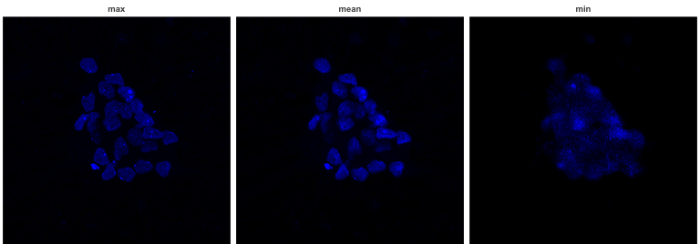
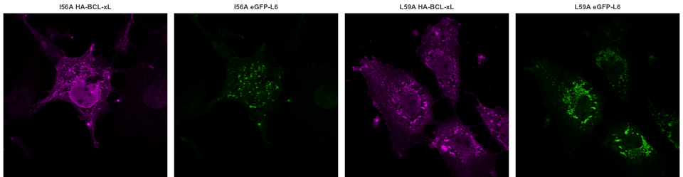
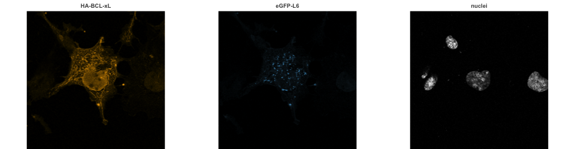

<!-- README.md is generated from README.Rmd. Please edit that file -->

# tidymontage

<!-- badges: start -->

[](https://github.com/jbengler/tidymontage/actions/workflows/R-CMD-check.yaml)
<!-- badges: end -->

The goal of tidymontage is to streamline the creation of
publication-ready microscopy figure montages. It is a sibling of
[tidyplots](https://github.com/jbengler/tidyplots): a tidy data frame of
images goes in, montage components are added with pipeable verbs, and a
ggplot comes out.

tidymontage is in early development. Reading images and processing them
with dplyr works; the montage renderer does not exist yet.

## Installation

You can install the development version of tidymontage from
[GitHub](https://github.com/jbengler/tidymontage) with:

``` r
# install.packages("pak")
pak::pak("jbengler/tidymontage")
```

## The data model

The examples below use the microscope exports in `demo_images/`. They
are not part of the package (too large), so run them from a local
checkout that has the folder.

### One row per image

`read_images()` takes files or directories and returns a long tibble
with one row per image: per file, channel, z-slice and time point. The
`img` column holds lazy references to **greyscale** images; no pixels
are read at this point.

``` r
library(tidymontage)
library(dplyr)
#> 
#> Attache Paket: 'dplyr'
#> Die folgenden Objekte sind maskiert von 'package:stats':
#> 
#>     filter, lag
#> Die folgenden Objekte sind maskiert von 'package:base':
#> 
#>     intersect, setdiff, setequal, union
library(tidyr)

images <- read_images("demo_images")
images
#> # A tibble: 46 x 20
#>    filepath   series channel_index channel     z     t    img color channel_name fluor size_x size_y
#>    <chr>       <int>         <int> <chr>   <int> <int>   <chr> <chr>        <chr>  <int>  <int>
#>  1 demo_imag~      1             1 Cy3         1     1 page 1 #FF0~ Ch2-T1       Cy3     1796   1796
#>  2 demo_imag~      1             2 Alexa ~     1     1 page 2 #00F~ Ch1-T2       Alex~   1796   1796
#>  3 demo_imag~      1             3 DAPI        1     1 page 3 #FFF~ Ch1-T3       DAPI    1796   1796
#>  4 demo_imag~      1             1 Cy3         1     1 page 1 #FF0~ Ch2-T1       Cy3     1796   1796
#>  5 demo_imag~      1             2 Alexa ~     1     1 page 2 #00F~ Ch1-T2       Alex~   1796   1796
#>  6 demo_imag~      1             3 DAPI        1     1 page 3 #FFF~ Ch1-T3       DAPI    1796   1796
#>  7 demo_imag~      1             1 C1          1     1 page 1 #FF0~ <NA>         <NA>    1796   1796
#>  8 demo_imag~      1             2 C2          1     1 page 2 #00F~ <NA>         <NA>    1796   1796
#>  9 demo_imag~      1             3 C3          1     1 page 3 #FFF~ <NA>         <NA>    1796   1796
#> 10 demo_imag~      1             1 Cy3         1     1 page 1 #FF0~ Ch2-T1       Cy3     1796   1796
#> # i 36 more rows
#> # i 8 more variables: size_z <int>, size_t <int>, bit_depth <int>, pixel_size <dbl>,
#> #   pixel_unit <chr>, z_step <dbl>, meta_source <chr>, pixel_size_source <chr>
```

How many images does each file contribute, and where did the metadata
come from?

``` r
images |>
  count(file = basename(filepath), meta_source, pixel_size_source, name = "images")
#> # A tibble: 7 x 4
#>   file                                                          meta_source pixel_size_source images
#>   <chr>                                                         <chr>       <chr>              <int>
#> 1 Cos7_eGFP-hL6-I56A_HA-hBCL-xL_63x_2019_12_20__12_23_13.ome.t~ ome-xml     ome-xml                3
#> 2 Cos7_eGFP-hL6-I56A_HA-hBCL-xL_63x_2019_12_20__12_23_13.tif    imagej      imagej                 3
#> 3 Cos7_eGFP-hL6-I56A_HA-hBCL-xL_63x_2019_12_20__12_23_13_OME.t~ imagej      tiff                   3
#> 4 Cos7_eGFP-hL6-L59A_HA-hBCL-xL_63x_2019_12_20__12_29_05.ome.t~ ome-xml     ome-xml                3
#> 5 Cos7_eGFP-hL6-L59A_HA-hBCL-xL_63x_2019_12_20__12_29_05.tif    imagej      imagej                 3
#> 6 Cos7_eGFP-hL6-L59A_HA-hBCL-xL_63x_2019_12_20__12_29_05_OME.t~ imagej      tiff                   3
#> 7 DIV14Actin-01-Airyscan Processing-02.tif                      imagej      imagej                28
```

Channel labels, colours and calibration come straight from the
microscope metadata:

``` r
images |>
  filter(grepl("Airyscan", filepath), z == 1) |>
  select(channel, channel_name, color, size_x, size_z, pixel_size, z_step)
#> # A tibble: 4 x 7
#>   channel         channel_name color   size_x size_z pixel_size z_step
#>   <chr>           <chr>        <chr>    <int>  <int>      <dbl>  <dbl>
#> 1 Alexa Fluor 647 AF647-T1     #FF00FF   2024      7     0.0707    1.8
#> 2 Alexa Fluor 555 AF555-T2     #FF0000   2024      7     0.0707    1.8
#> 3 Alexa Fluor 488 AF488-T3     #00FF33   2024      7     0.0707    1.8
#> 4 Hoechst 33258   H3258-T4     #0000FF   2024      7     0.0707    1.8
```

### A helper to look at images

The renderer does not exist yet, so for playing around here is a small
`peek()` helper. It reads the pixels of the `img` column (with the
internal `img_pixels()`), tints each image with its channel colour and
shows them side by side. Colour is only applied here, at display time:
the tibble itself only holds greyscale images.

``` r
peek <- function(data, label = channel, step = 4) {
  labels <- as.character(rlang::eval_tidy(rlang::enquo(label), data))
  colors <- if ("color" %in% names(data)) data$color else rep("#FFFFFF", nrow(data))
  pixels <- tidymontage:::img_pixels(data$img)
  op <- par(mfrow = c(1, length(pixels)), mar = c(0, 0, 1.5, 0))
  on.exit(par(op))
  for (i in seq_along(pixels)) {
    x <- pixels[[i]][seq(1, nrow(pixels[[i]]), step), seq(1, ncol(pixels[[i]]), step)]
    v <- pmin(x / quantile(x, 0.999), 1)
    rgb <- grDevices::col2rgb(colors[i])[, 1] / 255
    plot(as.raster(matrix(grDevices::rgb(v * rgb[1], v * rgb[2], v * rgb[3]), nrow(x))))
    title(labels[i], col.main = "grey30", cex.main = 0.9)
  }
}
```

Every row is an image you can look at:

``` r
stack <- images |> filter(grepl("Airyscan", filepath))

stack |>
  filter(channel == "Alexa Fluor 488", z %in% c(1, 3, 5, 7)) |>
  peek(label = paste("z =", z))
```



### Select images with `filter()`

A single z-slice of all channels:

``` r
stack |>
  filter(z == 4) |>
  peek()
```



### Project with `summarise()`

A maximum projection is a `summarise()` per channel. The result is still
lazy: `max of 7` is a recipe that is computed, plane by plane, only when
the pixels are needed.

``` r
projected <- stack |>
  summarise(img = max(img), .by = c(filepath, channel, color))
projected
#> # A tibble: 4 x 4
#>   filepath                                             channel         color        img
#>   <chr>                                                <chr>           <chr>      
#> 1 demo_images/DIV14Actin-01-Airyscan Processing-02.tif Alexa Fluor 647 #FF00FF max of 7
#> 2 demo_images/DIV14Actin-01-Airyscan Processing-02.tif Alexa Fluor 555 #FF0000 max of 7
#> 3 demo_images/DIV14Actin-01-Airyscan Processing-02.tif Alexa Fluor 488 #00FF33 max of 7
#> 4 demo_images/DIV14Actin-01-Airyscan Processing-02.tif Hoechst 33258   #0000FF max of 7
```

``` r
peek(projected)
```



Projections can be restricted to part of the stack, just by filtering
first:

``` r
stack |>
  filter(z %in% 3:5) |>
  summarise(img = max(img), .by = channel)
#> # A tibble: 4 x 2
#>   channel              img
#>   <chr>              
#> 1 Alexa Fluor 647 max of 3
#> 2 Alexa Fluor 555 max of 3
#> 3 Alexa Fluor 488 max of 3
#> 4 Hoechst 33258   max of 3
```

`max()`, `min()` and `mean()` are available. Several projections side by
side are just several summaries, and `pivot_longer()` turns them back
into rows:

``` r
projections <- stack |>
  filter(channel == "Hoechst 33258") |>
  summarise(max = max(img), mean = mean(img), min = min(img), .by = c(channel, color)) |>
  pivot_longer(c(max, mean, min), names_to = "projection", values_to = "img")
projections
#> # A tibble: 3 x 4
#>   channel       color   projection       img
#>   <chr>         <chr>   <chr>          
#> 1 Hoechst 33258 #0000FF max         max of 7
#> 2 Hoechst 33258 #0000FF mean       mean of 7
#> 3 Hoechst 33258 #0000FF min         min of 7
```

``` r
peek(projections, label = projection)
```



### Describe the experiment with `mutate()` and joins

Conditions, targets or anything else are ordinary columns. Here the
mutant is derived from the file name, and the stained protein comes from
a lookup table:

``` r
targets <- tribble(
  ~channel,          ~target,
  "Cy3",             "HA-BCL-xL",
  "Alexa Fluor 488", "eGFP-L6",
  "DAPI",            "nuclei"
)

cells <- images |>
  filter(grepl("\\.ome\\.tif$", filepath)) |>
  mutate(mutant = if_else(grepl("I56A", filepath), "I56A", "L59A")) |>
  left_join(targets, by = "channel")

cells |> select(mutant, channel, target, color, img)
#> # A tibble: 6 x 5
#>   mutant channel         target    color      img
#>   <chr>  <chr>           <chr>     <chr>    
#> 1 I56A   Cy3             HA-BCL-xL #FF00FF page 1
#> 2 I56A   Alexa Fluor 488 eGFP-L6   #00FF00 page 2
#> 3 I56A   DAPI            nuclei    #FFFFFF page 3
#> 4 L59A   Cy3             HA-BCL-xL #FF00FF page 1
#> 5 L59A   Alexa Fluor 488 eGFP-L6   #00FF00 page 2
#> 6 L59A   DAPI            nuclei    #FFFFFF page 3
```

``` r
cells |>
  filter(target != "nuclei") |>
  peek(label = paste(mutant, target))
```



Changing a colour is a `mutate()` as well. Nothing is re-read: colour is
only used when images are displayed.

``` r
cells |>
  filter(mutant == "I56A") |>
  mutate(color = case_match(channel, "Cy3" ~ "#E69F00", "Alexa Fluor 488" ~ "#56B4E9", "DAPI" ~ "#FFFFFF")) |>
  peek(label = target)
#> Warning: There was 1 warning in `mutate()`.
#> i In argument: `color = case_match(...)`.
#> Caused by warning:
#> ! `case_match()` was deprecated in dplyr 1.2.0.
#> i Please use `recode_values()` instead.
```



### Things that are refused

Images only support operations that make sense for images:

``` r
# summing intensities across images is not a projection
stack |> summarise(img = sum(img), .by = channel)
#> Error in `summarise()`:
#> i In argument: `img = sum(img)`.
#> i In group 1: `channel = "Alexa Fluor 647"`.
#> Caused by error:
#> ! `sum()` is not supported for images.
#> i Use `max()`, `min()` or `mean()` to project images.

# images have no natural order
stack |> arrange(img)
#> Error:
#> ! Images can't be sorted.

# projecting images of different sizes (2024 x 2024 and 1796 x 1796 pixels)
images |> summarise(img = max(img), .by = channel_index)
#> Error in `summarise()`:
#> i In argument: `img = max(img)`.
#> i In group 1: `channel_index = 1`.
#> Caused by error:
#> ! Can't compute `max()` of images with different sizes.
```

### Start a montage

Finally, the processed tibble goes into `tidymontage()`, with variables
mapped to the columns and rows of the figure:

``` r
tidymontage(cells, x = mutant, y = target)
#> <tidymontage> 6 images from 2 files, 3 channels
#> x: mutant  y: target
#> layout: <default>
#> steps:
#>   (none)
```

Printing a montage shows its recipe for now; once the renderer exists,
it will draw the figure: colours, merges, crops, zoom insets, labels and
scale bars, with linked exposure per channel.
