<!-- README.md is generated from README.Rmd. Please edit that file -->

# tidymontage

<!-- badges: start -->

[](https://github.com/jbengler/tidymontage/actions/workflows/R-CMD-check.yaml)
<!-- badges: end -->

The goal of tidymontage is to streamline the creation of
publication-ready microscopy figure montages. It is a sibling of
[tidyplots](https://github.com/jbengler/tidyplots): a tidy data frame of
images goes in, montage components are added with pipeable verbs, and a
figure of exact physical size comes out, ready to be placed next to
tidyplots with [tidylayouts](https://github.com/jbengler/tidylayouts).

tidymontage is in early development. Reading images, processing them
with dplyr, and building montages with merges, overlays, crops, zooms,
grid and hero layouts, colour legends and scale bars works.

## Installation

You can install the development version of tidymontage from
[GitHub](https://github.com/jbengler/tidymontage) with:

``` r
# install.packages("pak")
pak::pak("jbengler/tidymontage")
```

## Getting started

The examples below use the microscope exports in `demo_images/`. They
are not part of the package (too large), so run them from a local
checkout that has the folder.

### Microscope files

tidymontage reads TIFF and OME-TIFF. Convert files in microscope formats
(CZI, ND2, LIF, OIR, VSI, …) to OME-TIFF first, with ZEN, Fiji or the
Bio-Formats command line tool `bfconvert`; the article [Getting your
images
in](https://jbengler.github.io/tidymontage/articles/getting-images-in.html)
shows how, including a script for whole folders.

### A first montage

Read the images, describe the experiment with dplyr, and hand them to
`tidymontage()`. Here two cells, one per mutant, become one column each,
with their channels as rows. Display ranges are **linked per channel**,
so the brightness of both mutants can be compared:

``` r
library(tidymontage)
library(dplyr)
#> 
#> Attache Paket: 'dplyr'
#> Die folgenden Objekte sind maskiert von 'package:stats':
#> 
#>     filter, lag
#> Die folgenden Objekte sind maskiert von 'package:base':
#> 
#>     intersect, setdiff, setequal, union
library(tidyr)

cells <- read_images(list.files("demo_images", "\\.ome\\.tif$", full.names = TRUE)) |>
  mutate(mutant = if_else(grepl("I56A", filepath), "I56A", "L59A"))

cells |>
  tidymontage(x = mutant)
```

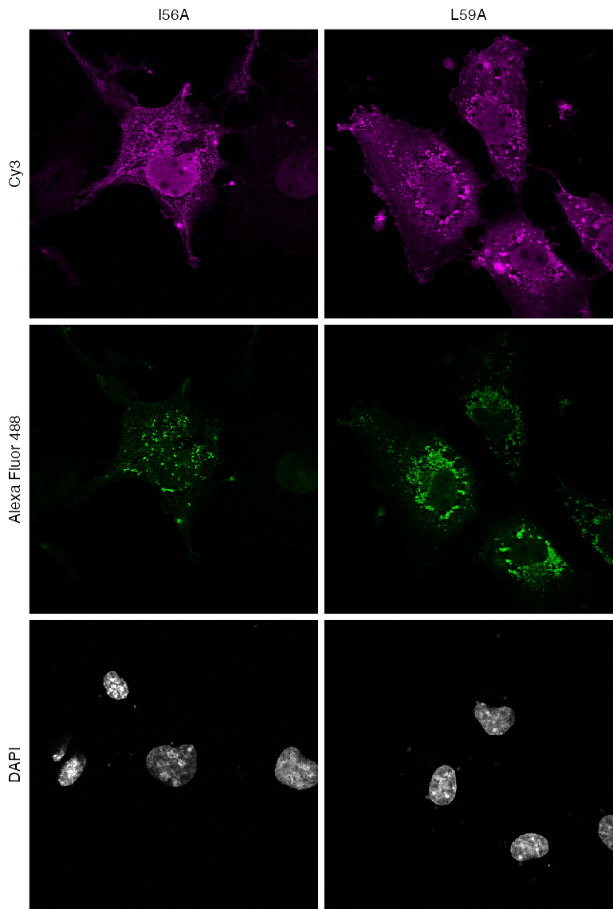

The rest of this README first looks at the data model, the tibble of
images, and then at what `tidymontage()` can do with it.

## The data model

### One row per image

`read_images()` takes files or directories and returns a long tibble
with one row per image: per file, channel, z-slice and time point. The
`img` column holds lazy references to **greyscale** images; no pixels
are read at this point. Colours are only applied when a montage is
drawn.

``` r
images <- read_images("demo_images")
images
#> # A tibble: 46 x 20
#>    filepath   series channel_index channel     z     t    img color channel_name fluor size_x size_y
#>    <chr>       <int>         <int> <chr>   <int> <int>   <chr> <chr>        <chr>  <int>  <int>
#>  1 demo_imag~      1             1 Cy3         1     1 page 1 #FF0~ Ch2-T1       Cy3     1796   1796
#>  2 demo_imag~      1             2 Alexa ~     1     1 page 2 #00F~ Ch1-T2       Alex~   1796   1796
#>  3 demo_imag~      1             3 DAPI        1     1 page 3 #FFF~ Ch1-T3       DAPI    1796   1796
#>  4 demo_imag~      1             1 Cy3         1     1 page 1 #FF0~ Ch2-T1       Cy3     1796   1796
#>  5 demo_imag~      1             2 Alexa ~     1     1 page 2 #00F~ Ch1-T2       Alex~   1796   1796
#>  6 demo_imag~      1             3 DAPI        1     1 page 3 #FFF~ Ch1-T3       DAPI    1796   1796
#>  7 demo_imag~      1             1 C1          1     1 page 1 #FF0~ <NA>         <NA>    1796   1796
#>  8 demo_imag~      1             2 C2          1     1 page 2 #00F~ <NA>         <NA>    1796   1796
#>  9 demo_imag~      1             3 C3          1     1 page 3 #FFF~ <NA>         <NA>    1796   1796
#> 10 demo_imag~      1             1 Cy3         1     1 page 1 #FF0~ Ch2-T1       Cy3     1796   1796
#> # i 36 more rows
#> # i 8 more variables: size_z <int>, size_t <int>, bit_depth <int>, pixel_size <dbl>,
#> #   pixel_unit <chr>, z_step <dbl>, meta_source <chr>, pixel_size_source <chr>
```

How many images does each file contribute, and where did the metadata
come from?

``` r
images |>
  count(file = basename(filepath), meta_source, pixel_size_source, name = "images")
#> # A tibble: 7 x 4
#>   file                                                          meta_source pixel_size_source images
#>   <chr>                                                         <chr>       <chr>              <int>
#> 1 Cos7_eGFP-hL6-I56A_HA-hBCL-xL_63x_2019_12_20__12_23_13.ome.t~ ome-xml     ome-xml                3
#> 2 Cos7_eGFP-hL6-I56A_HA-hBCL-xL_63x_2019_12_20__12_23_13.tif    imagej      imagej                 3
#> 3 Cos7_eGFP-hL6-I56A_HA-hBCL-xL_63x_2019_12_20__12_23_13_OME.t~ imagej      tiff                   3
#> 4 Cos7_eGFP-hL6-L59A_HA-hBCL-xL_63x_2019_12_20__12_29_05.ome.t~ ome-xml     ome-xml                3
#> 5 Cos7_eGFP-hL6-L59A_HA-hBCL-xL_63x_2019_12_20__12_29_05.tif    imagej      imagej                 3
#> 6 Cos7_eGFP-hL6-L59A_HA-hBCL-xL_63x_2019_12_20__12_29_05_OME.t~ imagej      tiff                   3
#> 7 DIV14Actin-01-Airyscan Processing-02.tif                      imagej      imagej                28
```

Channel labels, colours and calibration come straight from the
microscope metadata:

``` r
images |>
  filter(grepl("Airyscan", filepath), z == 1) |>
  select(channel, channel_name, color, size_x, size_z, pixel_size, z_step)
#> # A tibble: 4 x 7
#>   channel         channel_name color   size_x size_z pixel_size z_step
#>   <chr>           <chr>        <chr>    <int>  <int>      <dbl>  <dbl>
#> 1 Alexa Fluor 647 AF647-T1     #FF00FF   2024      7     0.0707    1.8
#> 2 Alexa Fluor 555 AF555-T2     #FF0000   2024      7     0.0707    1.8
#> 3 Alexa Fluor 488 AF488-T3     #00FF33   2024      7     0.0707    1.8
#> 4 Hoechst 33258   H3258-T4     #0000FF   2024      7     0.0707    1.8
```

### Select images with `filter()`

Every row is an image, and any selection of rows can be shown with
`tidymontage()`. Here four z-slices of one channel, with the slices as
columns. All slices share one display range, so the dimmer slices really
have less signal:

``` r
stack <- images |> filter(grepl("Airyscan", filepath))

stack |>
  filter(channel == "Alexa Fluor 488", z %in% c(1, 3, 5, 7)) |>
  tidymontage(x = z)
```

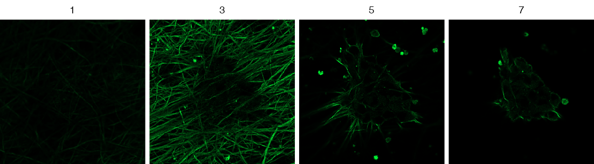

A single z-slice of all channels:

``` r
stack |>
  filter(z == 4) |>
  tidymontage()
```

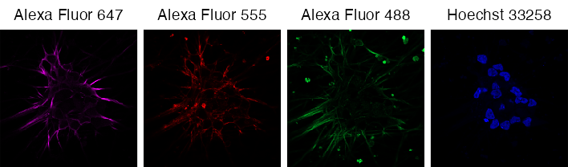

### Project with `summarise()`

A maximum projection is a `summarise()` per channel. The result is still
lazy: `max of 7` is a recipe that is computed, plane by plane, only when
the pixels are needed.

``` r
projected <- stack |>
  summarise(img = max(img), .by = c(filepath, channel, color))
projected
#> # A tibble: 4 x 4
#>   filepath                                             channel         color        img
#>   <chr>                                                <chr>           <chr>      
#> 1 demo_images/DIV14Actin-01-Airyscan Processing-02.tif Alexa Fluor 647 #FF00FF max of 7
#> 2 demo_images/DIV14Actin-01-Airyscan Processing-02.tif Alexa Fluor 555 #FF0000 max of 7
#> 3 demo_images/DIV14Actin-01-Airyscan Processing-02.tif Alexa Fluor 488 #00FF33 max of 7
#> 4 demo_images/DIV14Actin-01-Airyscan Processing-02.tif Hoechst 33258   #0000FF max of 7
```

``` r
tidymontage(projected)
```

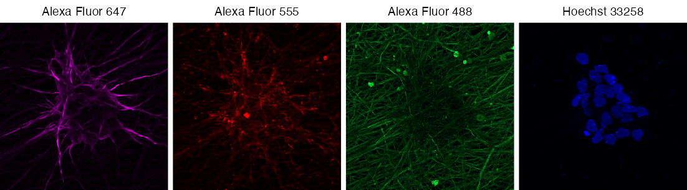

Projections can be restricted to part of the stack, just by filtering
first:

``` r
stack |>
  filter(z %in% 3:5) |>
  summarise(img = max(img), .by = channel)
#> # A tibble: 4 x 2
#>   channel              img
#>   <chr>              
#> 1 Alexa Fluor 647 max of 3
#> 2 Alexa Fluor 555 max of 3
#> 3 Alexa Fluor 488 max of 3
#> 4 Hoechst 33258   max of 3
```

`max()`, `min()` and `mean()` are available. Several projections side by
side are just several summaries, and `pivot_longer()` turns them back
into rows:

``` r
projections <- stack |>
  filter(channel == "Hoechst 33258") |>
  summarise(max = max(img), mean = mean(img), min = min(img), .by = c(filepath, channel, color)) |>
  pivot_longer(c(max, mean, min), names_to = "projection", values_to = "img")
projections
#> # A tibble: 3 x 5
#>   filepath                                             channel       color   projection       img
#>   <chr>                                                <chr>         <chr>   <chr>          
#> 1 demo_images/DIV14Actin-01-Airyscan Processing-02.tif Hoechst 33258 #0000FF max         max of 7
#> 2 demo_images/DIV14Actin-01-Airyscan Processing-02.tif Hoechst 33258 #0000FF mean       mean of 7
#> 3 demo_images/DIV14Actin-01-Airyscan Processing-02.tif Hoechst 33258 #0000FF min         min of 7
```

``` r
tidymontage(projections, x = projection)
```

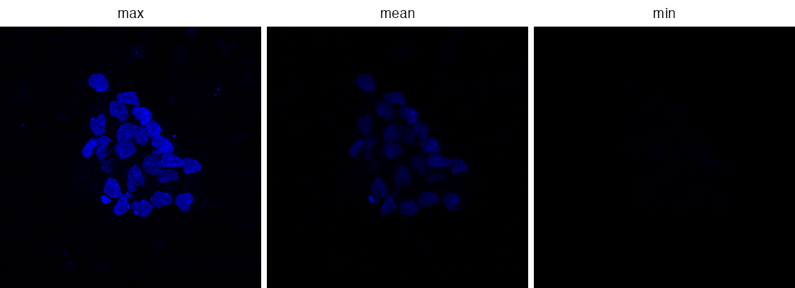

All three projections are images of the same channel, so they share one
display range: the minimum projection really is that dim. To stretch
each one on its own, unlink them on purpose with
`adjust_exposure(.by = c(channel, projection))`.

### Describe the experiment with `mutate()` and joins

Conditions, targets or anything else are ordinary columns. The mutant
came from the file name above; the stained protein comes from a lookup
table:

``` r
targets <- tribble(
  ~channel,          ~target,
  "Cy3",             "HA-BCL-xL",
  "Alexa Fluor 488", "eGFP-L6",
  "DAPI",            "nuclei"
)

cells <- cells |>
  left_join(targets, by = "channel")

cells |> select(mutant, channel, target, color, img)
#> # A tibble: 6 x 5
#>   mutant channel         target    color      img
#>   <chr>  <chr>           <chr>     <chr>    
#> 1 I56A   Cy3             HA-BCL-xL #FF00FF page 1
#> 2 I56A   Alexa Fluor 488 eGFP-L6   #00FF00 page 2
#> 3 I56A   DAPI            nuclei    #FFFFFF page 3
#> 4 L59A   Cy3             HA-BCL-xL #FF00FF page 1
#> 5 L59A   Alexa Fluor 488 eGFP-L6   #00FF00 page 2
#> 6 L59A   DAPI            nuclei    #FFFFFF page 3
```

Columns like `target` can be used in the montage right away:

``` r
cells |>
  filter(target != "nuclei") |>
  tidymontage(x = mutant, y = target)
```

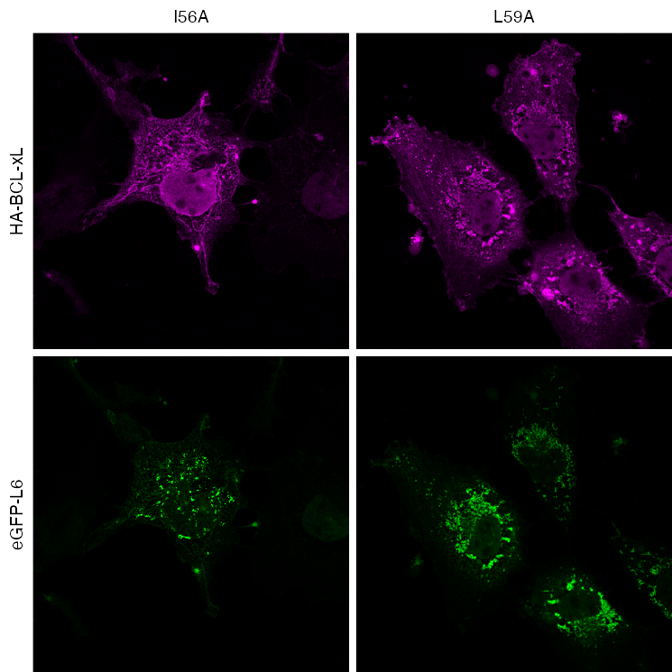

The `color` column holds the default colour of each image, so changing
it is a `mutate()` as well. Nothing is re-read: colour is only used when
images are drawn. (Within a montage, `adjust_colors()` does the same.)

``` r
cells |>
  filter(mutant == "I56A") |>
  mutate(color = case_match(channel, "Cy3" ~ "#E69F00", "Alexa Fluor 488" ~ "#56B4E9", "DAPI" ~ "#FFFFFF")) |>
  tidymontage(x = target)
#> Warning: There was 1 warning in `mutate()`.
#> i In argument: `color = case_match(...)`.
#> Caused by warning:
#> ! `case_match()` was deprecated in dplyr 1.2.0.
#> i Please use `recode_values()` instead.
```

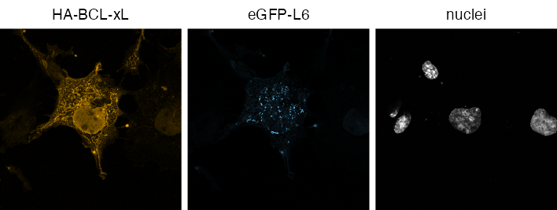

### Things that are refused

Images only support operations that make sense for images:

``` r
# summing intensities across images is not a projection
stack |> summarise(img = sum(img), .by = channel)
#> Error in `summarise()`:
#> i In argument: `img = sum(img)`.
#> i In group 1: `channel = "Alexa Fluor 647"`.
#> Caused by error:
#> ! `sum()` is not supported for images.
#> i Use `max()`, `min()` or `mean()` to project images.

# images have no natural order
stack |> arrange(img)
#> Error:
#> ! Images can't be sorted.

# projecting images of different sizes (2024 x 2024 and 1796 x 1796 pixels)
images |> summarise(img = max(img), .by = channel_index)
#> Error in `summarise()`:
#> i In argument: `img = max(img)`.
#> i In group 1: `channel_index = 1`.
#> Caused by error:
#> ! Can't compute `max()` of images with different sizes.
```

## Build a montage

Like `tidyplot()` in tidyplots, `tidymontage()` takes the mapping:
columns mapped to `x` and `y` (here `mutant`) arrange blocks of panels,
and the **layout** arranges the channels and views within them. The
default grid puts the channels on the free axis:

``` r
cells |>
  tidymontage(x = mutant)
```


``` r
cells |>
  tidymontage(y = mutant)
```

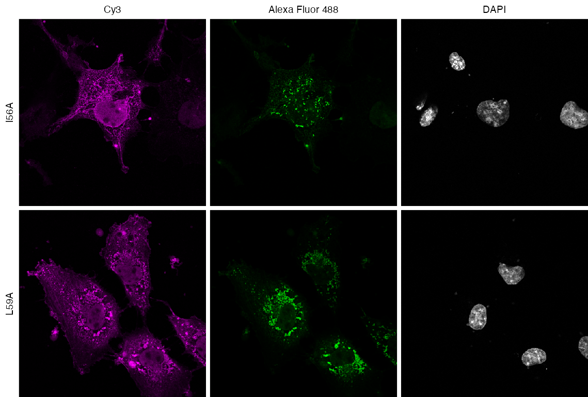

From there on, `add_*()` and `adjust_*()` verbs decide everything about
display: merges, colours, display ranges, crops, zooms and scale bars.

### Merges

`add_merge()` adds a merge of channels as a virtual channel. It takes
its place in the layout like any other channel. Mapping `channel` (or a
column determined by it, such as `target`) yourself overrides where the
layout puts it:

``` r
cells |>
  tidymontage(x = target, y = mutant) |>
  add_merge(Cy3, `Alexa Fluor 488`, DAPI, name = "merge")
```

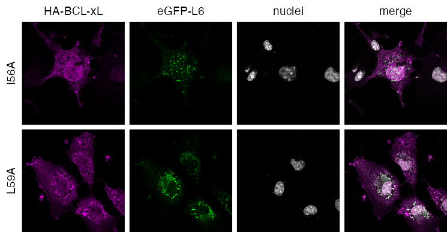

Channels are blended additively, each with its own colour and linked
display range. Member channels don’t need panels of their own, and
several merges are possible:

``` r
cells |>
  tidymontage(x = c(mutant, channel), channel = c("proteins", "all")) |>
  add_merge(Cy3, `Alexa Fluor 488`, name = "proteins") |>
  add_merge(Cy3, `Alexa Fluor 488`, DAPI, name = "all")
```

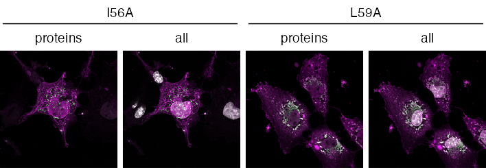

Display ranges are **linked per channel** by default: both mutants share
one range per channel, so their brightness can be compared.
`adjust_exposure()` changes the percentiles or sets values, and
`adjust_colors()` overrides the colours from the metadata:

``` r
montage <- projected |>
  tidymontage() |>
  adjust_colors(`Hoechst 33258` = "#56B4E9") |>
  adjust_exposure(min = "p0.1", max = "p99.8") |>
  add_merge(`Alexa Fluor 647`, `Alexa Fluor 555`, `Alexa Fluor 488`, `Hoechst 33258`)
montage
```

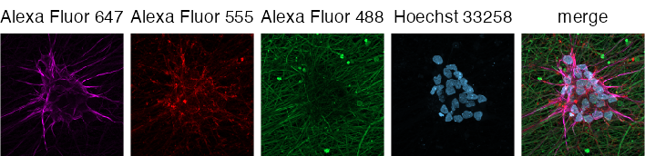

### Overlays: where channels coincide

`add_overlay()` adds a panel that is bright only where all of its
channels are bright, in a single colour. It is the minimum of the
channels’ display- scaled intensities, so it is as bright as the weakest
channel and isn’t stretched again: a faint overlap looks faint.

``` r
cells |>
  tidymontage(x = mutant, channel = c("merge", "overlap")) |>
  add_merge(Cy3, `Alexa Fluor 488`) |>
  add_overlay(Cy3, `Alexa Fluor 488`, name = "overlap", color = "yellow") |>
  add_color_legend()
```

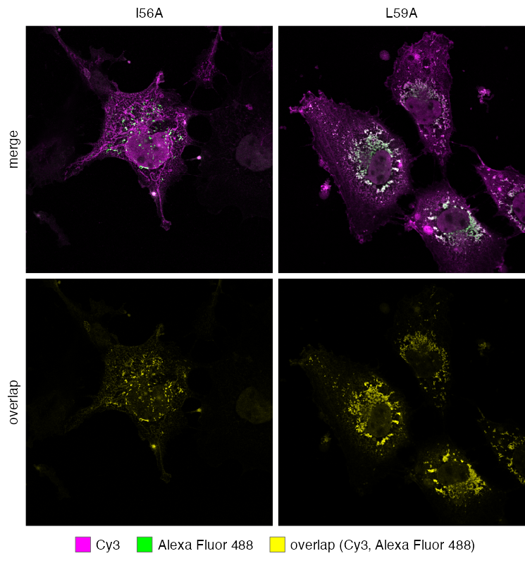

### Black channels: dark signal on white

A channel coloured black is shown inverted: dark signal on a white
background, with a thin frame. Merges always stay on black: there, black
channels use their original colour from the metadata, and `colors` in
`add_merge()` colours members differently in the merge only. Here both
proteins are black on their own, and the merge shows Cy3 in its original
magenta and Alexa Fluor 488 in yellow:

``` r
cells |>
  tidymontage(x = mutant, channel = c("Cy3", "Alexa Fluor 488", "merge")) |>
  adjust_colors(Cy3 = "black", `Alexa Fluor 488` = "black") |>
  add_merge(Cy3, `Alexa Fluor 488`, colors = c(`Alexa Fluor 488` = "yellow")) |>
  add_color_legend()
```

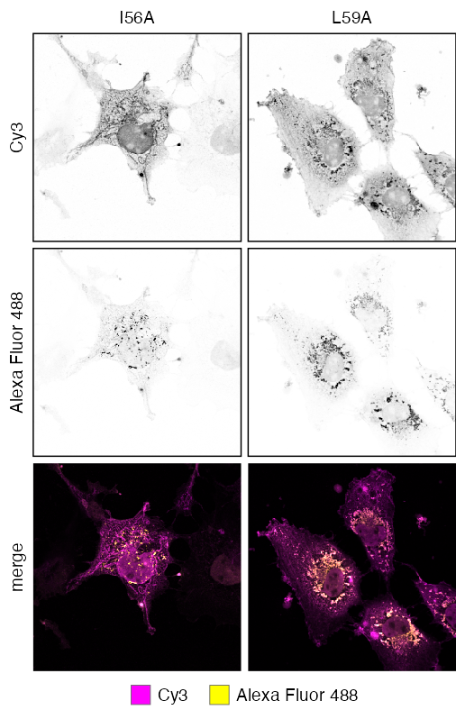

### Colormaps

Instead of a single colour, `lut()` colours a channel with a colormap
such as magma or viridis. Perceptually uniform maps show differences in
intensity more faithfully, which helps with quantitative images.
Overlays can use a colormap too. Merges need single colours, so there,
colormap channels use their original colour, like black channels do. The
legend shows colormaps as colour bars, labelled with the display range:

``` r
cells |>
  tidymontage(x = mutant, channel = c("Cy3", "overlap", "merge")) |>
  adjust_colors(Cy3 = lut("magma")) |>
  add_overlay(Cy3, `Alexa Fluor 488`, name = "overlap", color = lut("viridis")) |>
  add_merge(Cy3, `Alexa Fluor 488`) |>
  add_color_legend()
```

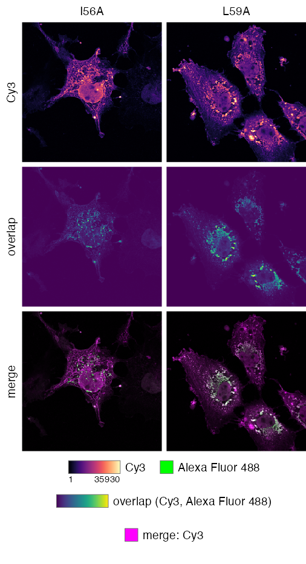

### Crops and zooms

`add_crop()` shows a region of each image. The size is given once, in
micrometres, so all panels share one magnification; only the position
can differ between images. Positions are the region’s center, relative
to the full image (0-1), here one per mutant.

`add_zoom()` adds a blow-up as a new **view**: panels of their own,
which the grid places next to the main panels. A box marks the region on
the main panels, here only on the merges:

``` r
crops <- tribble(
  ~mutant, ~x,   ~y,
  "I56A",  0.47, 0.40,
  "L59A",  0.42, 0.55
)
zooms <- tribble(
  ~mutant, ~x,   ~y,
  "I56A",  0.50, 0.40,
  "L59A",  0.40, 0.48
)

cells |>
  tidymontage(x = mutant) |>
  add_merge(Cy3, `Alexa Fluor 488`, DAPI) |>
  add_crop(width = 60, center = crops) |>
  add_zoom(width = 15, center = zooms, box = "merge")
```

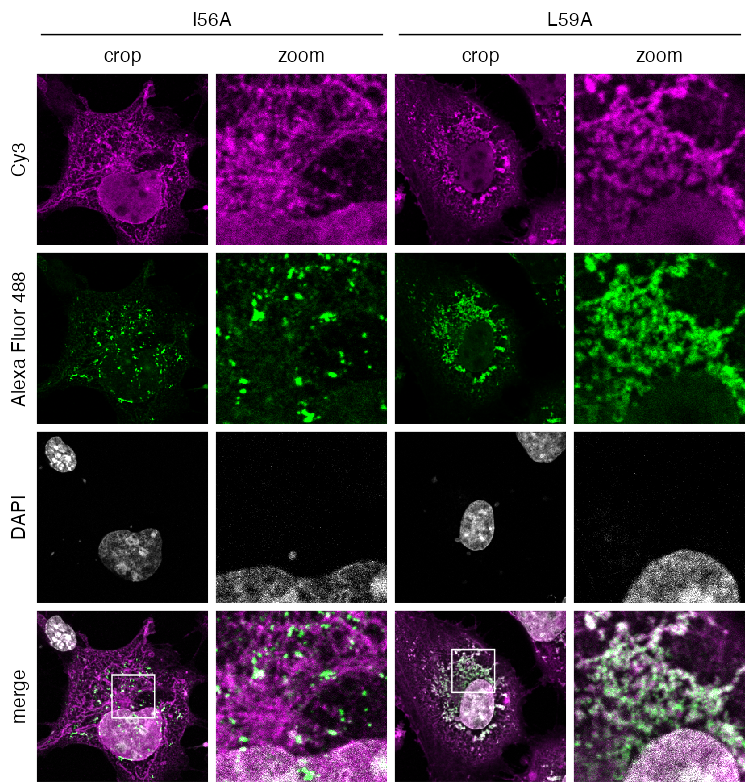

``` r
cells |>
  tidymontage(x = mutant) |>
  add_merge(Cy3, `Alexa Fluor 488`, DAPI) |>
  add_crop(width = 60, center = crops) |>
  add_zoom(width = 15, center = zooms, box = "merge") |> 
  preview_positions()
```

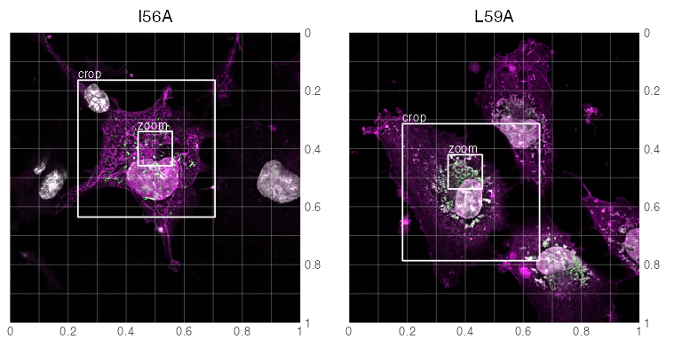

``` r
cells |>
  tidymontage(x = mutant) |>
  add_merge(Cy3, `Alexa Fluor 488`, DAPI) |>
  add_crop(width = 60, center = crops) |>
  add_zoom(width = 15, center = zooms, box = "merge") |> 
  preview_exposure("DAPI")
#> i "DAPI": 'Cos7_eGFP-hL6-I56A_HA-hBCL-xL_63x_2019_12_20__12_23_13.ome.tif' (the brightest of 2
#>   images).
#> i Percentiles from 2 images sharing its display range.
```


Display ranges are computed from the full images, so cropping doesn’t
change brightness. Map `view` yourself to put views elsewhere, and
choose levels as usual:

``` r
cells |>
  tidymontage(x = mutant, y = view, channel = "merge") |>
  add_merge(Cy3, `Alexa Fluor 488`, DAPI) |>
  add_zoom(width = 20, center = zooms)
```

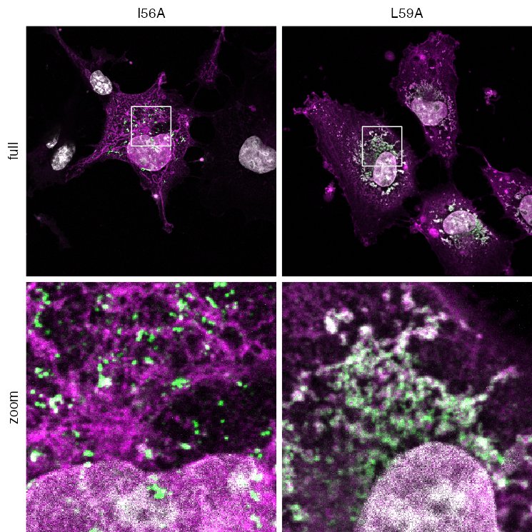

### Arrowheads

`add_arrows()` points at locations with arrowheads. An arrowhead belongs
to an image, not to a channel: it is drawn at the same place in every
panel of that image, merges included, and in zooms wherever its tip is
inside. Positions are given like the centers of crops, here several per
mutant. Arrowheads are white on dark panels and black on light ones:

``` r
arrows <- tribble(
  ~mutant, ~x,   ~y,
  "I56A",  0.50, 0.42,
  "I56A",  0.56, 0.36,
  "L59A",  0.41, 0.50
)

cells |>
  tidymontage(x = mutant, channel = c("Cy3", "Alexa Fluor 488", "merge")) |>
  adjust_colors(`Alexa Fluor 488` = "black") |>
  add_merge(Cy3, `Alexa Fluor 488`) |>
  add_arrows(arrows)
```

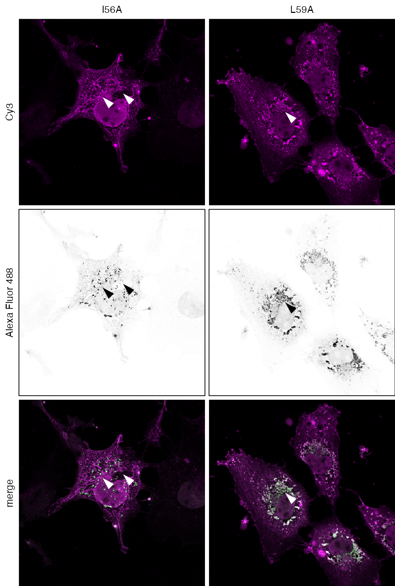

### Finding exposure and positions

Two previews help to find the ballpark before fine-tuning the arguments.
`preview_exposure()` shows one image of a channel with 25 combinations
of display ranges, ordered by how the image looks: brighter to the right
(lower `max`), darker background downwards (higher `min`). The current
setting is outlined. The percentiles come from all images of the
channel, as in the montage:

``` r
montage_cz <- cells |>
  tidymontage(x = mutant) |>
  add_merge(Cy3, `Alexa Fluor 488`, DAPI) |>
  add_crop(width = 60, center = crops) |>
  add_zoom(width = 15, center = zooms)

montage_cz |>
  preview_exposure("Cy3")
#> i "Cy3": 'Cos7_eGFP-hL6-L59A_HA-hBCL-xL_63x_2019_12_20__12_29_05.ome.tif' (the brightest of 2
#>   images).
#> i Percentiles from 2 images sharing its display range.
```

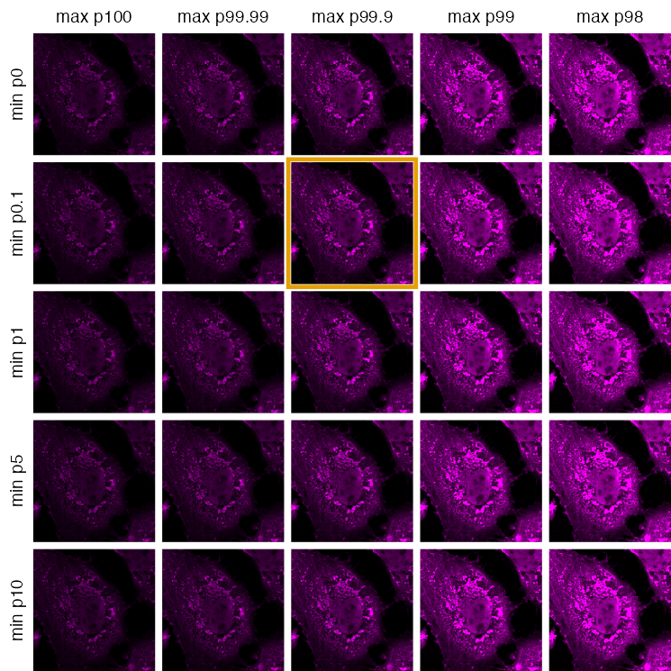

`preview_positions()` shows the full images with relative axes from 0 to
1, the values that `center` in `add_crop()` and `add_zoom()` expects.
The current crop and zoom are outlined, which also shows their size:

``` r
montage_cz |>
  preview_positions()
```


### Hero layout

Layouts work like themes: the same montage with `layout = "hero"` shows
one big panel per block, by default the merge of the crop, next to the
single channels of the zoom, labelled outside the images. Nothing else
changes:

``` r
cells |>
  tidymontage(x = mutant, layout = "hero") |>
  add_merge(Cy3, `Alexa Fluor 488`, DAPI) |>
  add_crop(width = 60, center = crops) |>
  add_zoom(width = 15, center = zooms) |>
  add_scale_bar()
```

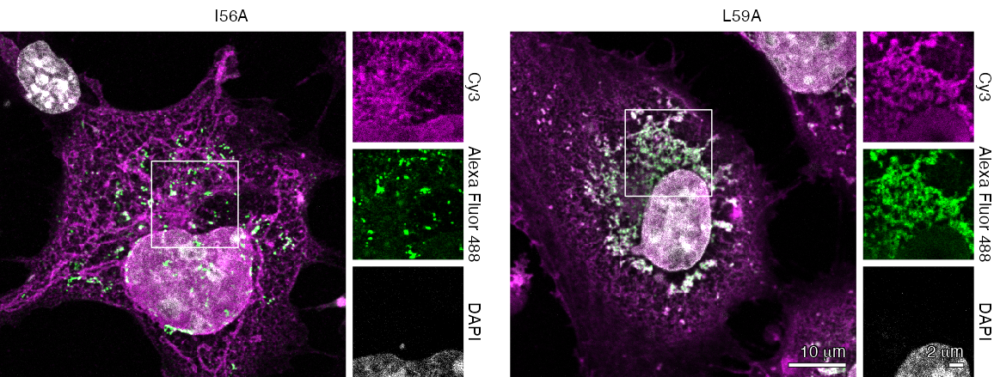

`layout_hero()` moves the small panels to the `"bottom"` or `"left"`,
`labels = FALSE` removes their labels, and `panel()` chooses other hero
or side panels:

``` r
cells |>
  tidymontage(x = mutant, layout = layout_hero(position = "bottom", labels = FALSE)) |>
  add_merge(Cy3, `Alexa Fluor 488`, DAPI) |>
  add_crop(width = 60, center = crops) |>
  add_zoom(width = 15, center = zooms) |> 
  add_scale_bar() |> 
  adjust_colors(DAPI = "#F1CD36") |> 
  add_color_legend(position = "bottom")
```

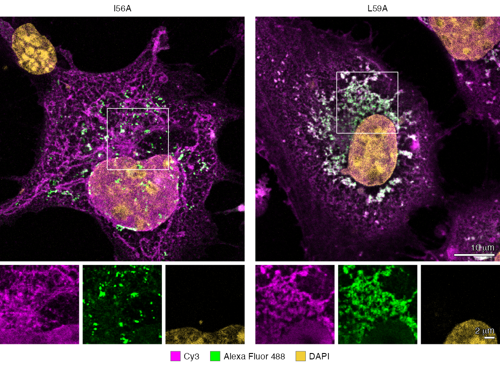

``` r
cells |>
  tidymontage(x = mutant, layout = layout_hero(position = "bottom", side = panel(channel = c("Cy3", "Alexa Fluor 488", "merge"), view = c("zoom")))) |>
  add_merge(Cy3, `Alexa Fluor 488`, DAPI) |>
  add_crop(width = 60, center = crops) |>
  add_zoom(width = 15, center = zooms) |> 
  add_scale_bar() |> 
  adjust_colors(DAPI = "#F1CD36")
```

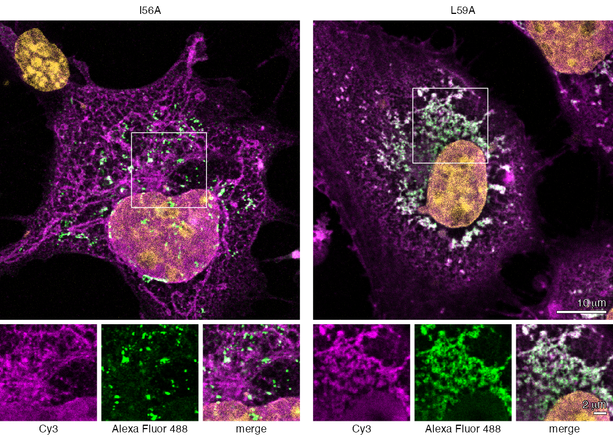

``` r
cells |>
  tidymontage(x = mutant, layout = layout_hero(position = "bottom", side = panel(channel = c("Cy3", "Alexa Fluor 488", "merge"), view = c("zoom")))) |>
  add_merge(Cy3, `Alexa Fluor 488`, DAPI, colors = c(DAPI = "#F1CD36")) |>
  add_crop(width = 60, center = crops) |>
  add_zoom(width = 15, center = zooms) |> 
  add_scale_bar() |> 
  adjust_colors(DAPI = "#000000", Cy3 = "#000000", `Alexa Fluor 488` = "#000000")
```

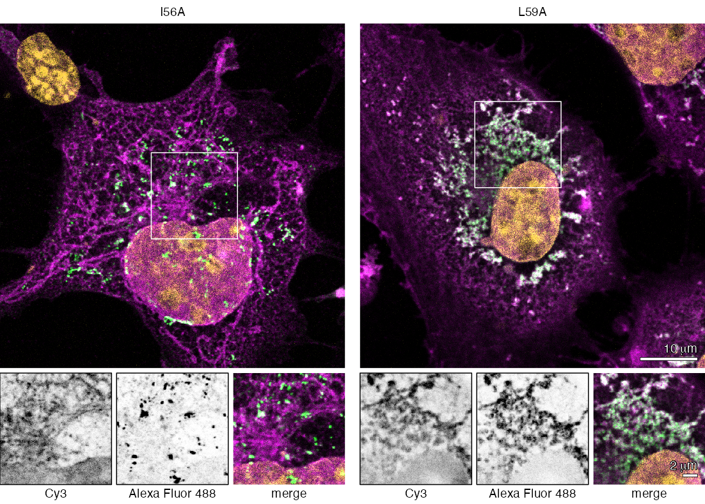

``` r
cells |>
  tidymontage(x = mutant, layout = layout_hero(position = "bottom")) |>
  add_merge(Cy3, `Alexa Fluor 488`, DAPI, colors = c(DAPI = "#F1CD36")) |>
  add_crop(width = 60, center = crops) |>
  add_zoom(width = 15, center = zooms) |> 
  add_scale_bar() |> 
  adjust_colors(DAPI = "#000000", Cy3 = "#000000", `Alexa Fluor 488` = "#000000")
```

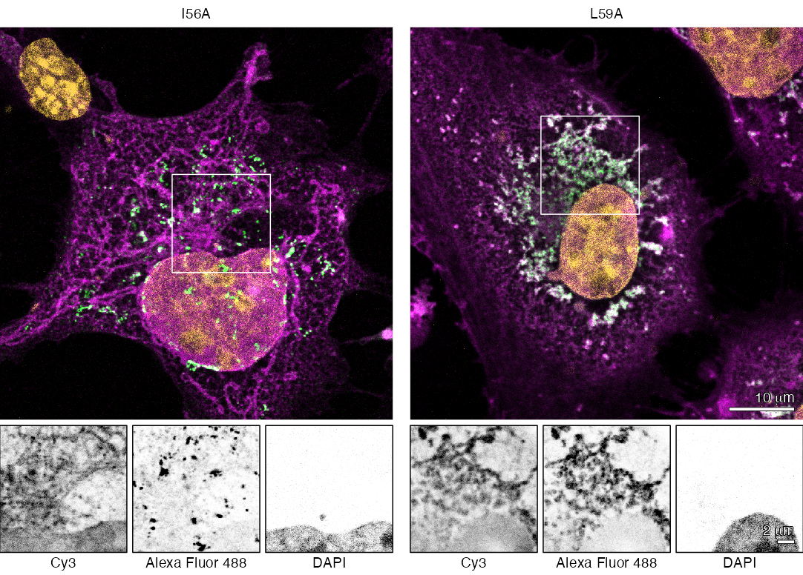

``` r
cells |>
  tidymontage(x = mutant) |>
  add_merge(Cy3, `Alexa Fluor 488`, DAPI, colors = c(DAPI = "#F1CD36")) |>
  add_crop(width = 60, center = crops) |>
  add_zoom(width = 15, center = zooms) |> 
  add_scale_bar() |> 
  adjust_colors(DAPI = "#000000", Cy3 = "#000000", `Alexa Fluor 488` = "#000000")
```

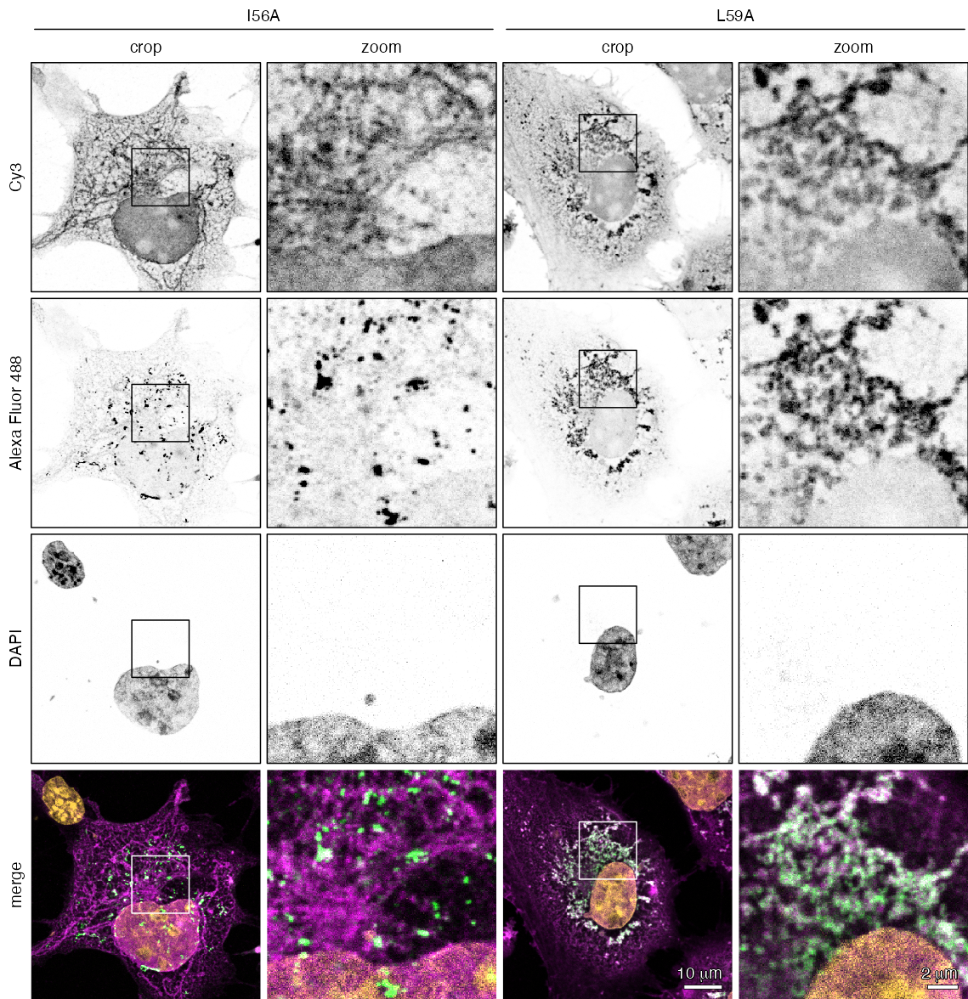

### Colour legend

`add_color_legend()` explains the colours, like a ggplot2 legend: a
swatch and the name of each channel shown, including the members of
merges. In a hero layout, it can replace the labels of the small panels.
It goes at the bottom (the default), on top or on the right, outside the
panels, so the montage grows and the panels keep their size:

``` r
cells |>
  tidymontage(x = mutant, layout = layout_hero(position = "bottom", labels = FALSE)) |>
  add_merge(Cy3, `Alexa Fluor 488`, DAPI) |>
  add_crop(width = 60, center = crops) |>
  add_zoom(width = 15, center = zooms) |>
  add_scale_bar() |>
  add_color_legend()
```

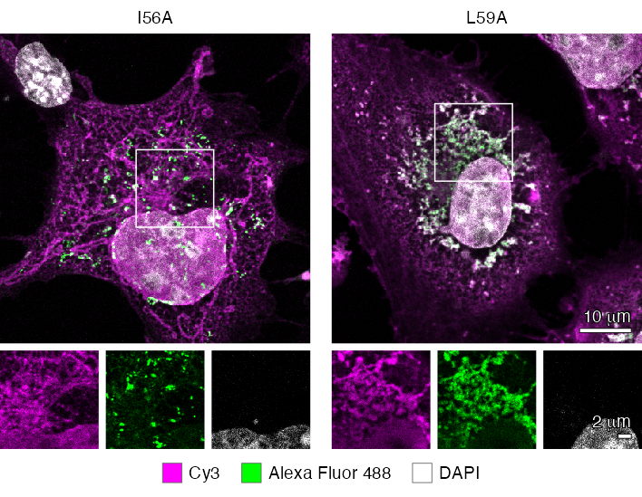

### Scale bars and headers

`add_scale_bar()` draws one scale bar per view, in its bottom-right
panel; all panels of a view share one magnification, so one bar is
enough. Without a length, a round length of about a fifth of the panel
is chosen. Scale bars need a known pixel size.

Row and column headers name the mapped levels. When several dimensions
share an axis, the headers are nested; `adjust_headers()` hides or
restyles them:

``` r
cells |>
  tidymontage(x = mutant) |>
  add_merge(Cy3, `Alexa Fluor 488`, DAPI) |>
  add_crop(width = 60, center = crops) |>
  add_zoom(width = 15, center = zooms, box = "merge") |>
  add_scale_bar()
```

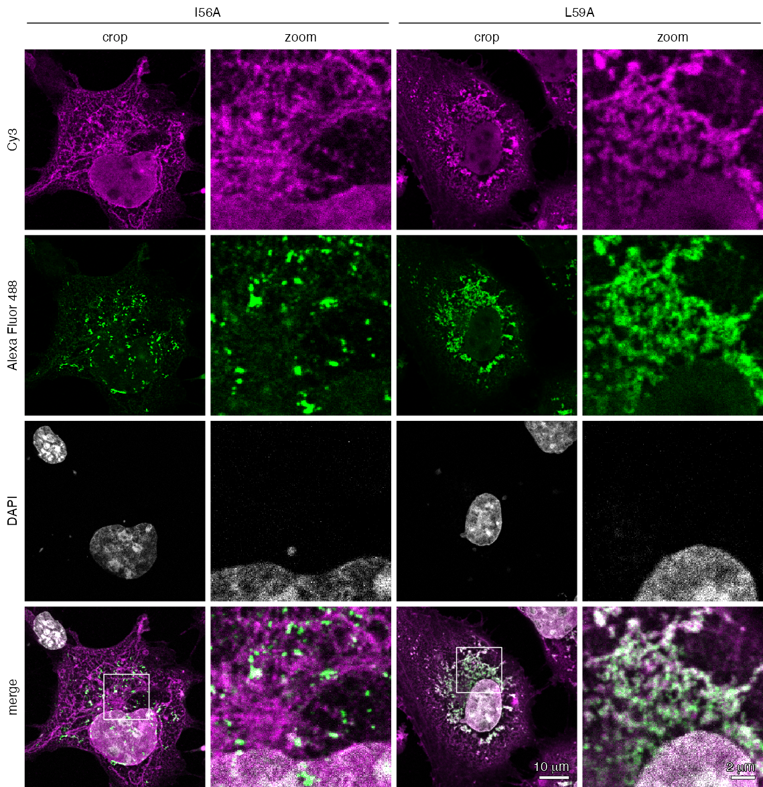

### Recipes and exact sizes

The montage keeps its recipe, and `get_panels()` shows the layout in mm
without reading any pixels:

``` r
cat(format(montage), sep = "\n")
#> <tidymontage> 4 images from 1 file, 4 channels
#> tidymontage(images, width = 140, height = 140)
#> steps:
#>   1. adjust_colors(`Hoechst 33258` = "#56B4E9")
#>   2. adjust_exposure(min = "p0.1", max = "p99.8", .by = channel)
#>   3. add_merge(`Alexa Fluor 647`, `Alexa Fluor 555`, `Alexa Fluor 488`, `Hoechst 33258`, name = "merge")
get_panels(montage)
#> # A tibble: 5 x 15
#>     col   row channel view   xmin  ymin  xmax  ymax merge overlay background px_xmin px_xmax px_ymin
#>   <int> <int> <chr>   <chr> <dbl> <dbl> <dbl> <dbl> <lgl> <lgl>   <chr>        <dbl>   <dbl>   <dbl>
#> 1     1     1 Alexa ~ full    0    4.69  27.2  31.9 FALSE FALSE   black            1    2024       1
#> 2     2     1 Alexa ~ full   28.2  4.69  55.4  31.9 FALSE FALSE   black            1    2024       1
#> 3     3     1 Alexa ~ full   56.4  4.69  83.6  31.9 FALSE FALSE   black            1    2024       1
#> 4     4     1 Hoechs~ full   84.6  4.69 112.   31.9 FALSE FALSE   black            1    2024       1
#> 5     5     1 merge   full  113.   4.69 140    31.9 TRUE  FALSE   black            1    2024       1
#> # i 1 more variable: px_ymax <dbl>
```

Like plots in tidyplots, montages have a **fixed physical size**: by
default, the panels and gaps (without headers) fit into a box of 90 x 90
mm, keeping the shape of the panels. Set the size in `tidymontage()` or
later with `adjust_size()`; `NA` leaves one side free.
`tidymontage_options()` changes the default for all montages of a
session; this README uses
`tidymontage_options(width = 140, height = 140)`. Printing and saving
use the same size, so the figure looks the same on screen and in the
file:

``` r
montage |>
  adjust_size(width = 180, height = NA) |>
  save_montage("figure.pdf")
#> Saved figure.pdf (180 x 40.2 mm).
```

### The layout explains itself

Every panel must show exactly one image, and the montage says so when it
doesn’t:

``` r
# two mutants, but only channels are mapped
cells |> tidymontage(x = channel) |> get_panels()
#> Error in `get_panels()`:
#> ! 2 images would share one panel (channel = Cy3).
#> i Each panel shows one image. Summarise z-slices or time points first, e.g. `summarise(img =
#>   max(img), .by = ...)`, or map another column such as filepath to `x` or `y`.

# levels can be chosen and ordered
cells |>
  tidymontage(x = mutant, channel = "DAPI") |>
  get_panels()
#> # A tibble: 2 x 16
#>     col   row channel view  mutant  xmin  ymin  xmax  ymax merge overlay background px_xmin px_xmax
#>   <int> <int> <chr>   <chr> <chr>  <dbl> <dbl> <dbl> <dbl> <lgl> <lgl>   <chr>        <dbl>   <dbl>
#> 1     1     1 DAPI    full  I56A     0    4.69  69.5  74.2 FALSE FALSE   black            1    1796
#> 2     2     1 DAPI    full  L59A    70.5  4.69 140    74.2 FALSE FALSE   black            1    1796
#> # i 2 more variables: px_ymin <dbl>, px_ymax <dbl>

# unlinking display ranges across channels is possible, but flagged
tidymontage(cells, x = mutant) |> adjust_exposure(.by = mutant)
#> Warning: A display range is shared by several channels.
#> i Display ranges are usually linked per channel: include channel in `.by` of `adjust_exposure()`.
```

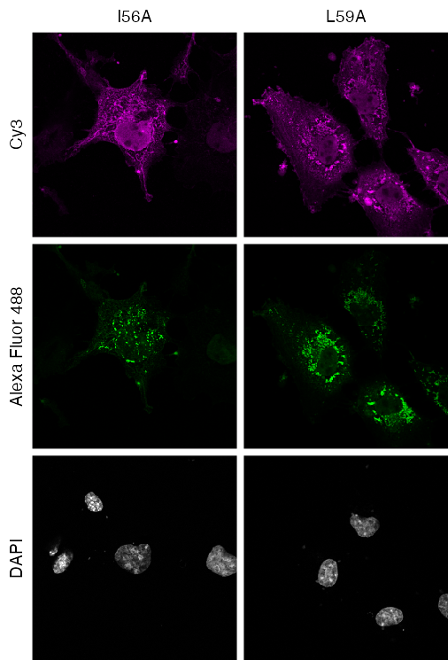
